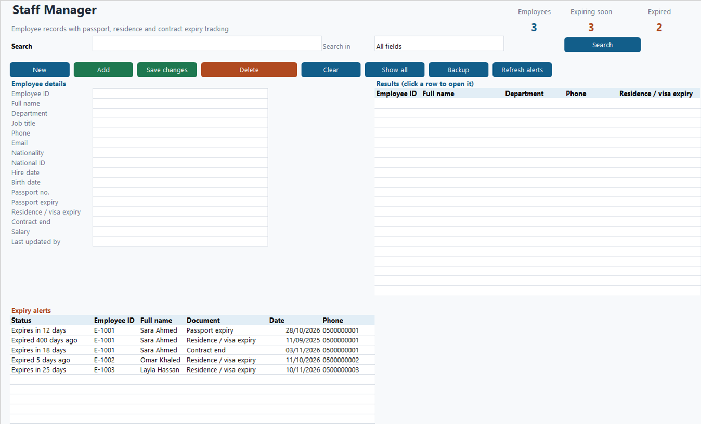
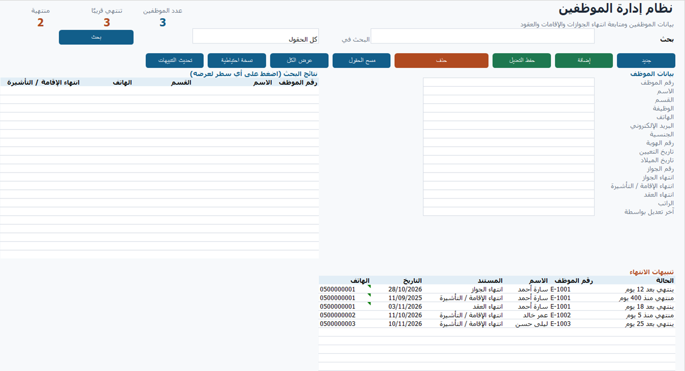

# Staff Manager for Excel (English + Arabic) · نظام إدارة الموظفين بالإكسل

## Summary (short line)
Employee records with one-click search, edit, archive, backups and passport / residence / contract expiry alerts. English and Arabic versions included.

## الوصف بالعربي

احفظ بيانات كل موظفيك في ملف إكسل واحد، ولا تفوّتك أي إقامة أو جواز أو عقد على وشك الانتهاء.

- نسختان جاهزتان: عربي وإنجليزي، بنفس المزايا
- واجهة واحدة بأزرار: جديد، إضافة، حفظ التعديل، حذف، مسح، عرض الكل، نسخة احتياطية، تحديث التنبيهات
- 16 حقلًا لكل موظف، وبحث بأي حقل، والضغط على النتيجة يفتحها
- تنبيهات انتهاء الجوازات والإقامات والعقود (المنتهية أو خلال 30 يومًا، قابلة للتعديل)
- أرشيف للموظفين المحذوفين، وسجل لكل عملية، ونسخة احتياطية بضغطة
- يعمل على ويندوز بأي لغة، إكسل 2013 أو أحدث

## Download · التحميل

Free for now: [StaffManager-EN.xlsm](StaffManager-EN.xlsm) · [StaffManager-AR.xlsm](StaffManager-AR.xlsm) · [README.txt](README.txt)

مجاني حاليًا: حمّل الملف، وبعدين كليك يمين > Properties > Unblock قبل الفتح.

---

**Need it customised, or a full version for your work?** [Message us on Telegram](https://t.me/mostafa_ideas_2050_bot?start=r_arabic_sm), no sign-up.

**محتاج نسخة مخصصة أو كاملة لشغلك؟** [ابعتلنا على تليجرام](https://t.me/mostafa_ideas_2050_bot?start=r_arabic_sm) من غير تسجيل.
